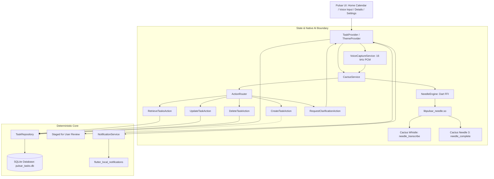

# Pulsar — Modules & Architecture Guide

Welcome to the comprehensive architecture guide for **Pulsar**.

This document provides a human-written explanation of every component, module, service, widget, and Action Module in this codebase, explaining what they do, why they exist, and how they connect to one another.

---

## Table of Contents
1. [High-Level Architecture & Design Philosophy](#1-high-level-architecture--design-philosophy)
2. [Visual Design System & Pulsar Neutron Star Branding](#2-visual-design-system--pulsar-neutron-star-branding)
3. [AI Engine: Cactus Whistle & Cactus Needle](#3-ai-engine-native-on-device-cactus-whistle--needle-ffi)
4. [Action Modules Architecture (Constrained Mini-LLM Control)](#4-action-modules-architecture-constrained-mini-llm-control)
   - [RetrieveTasksAction (`retrieve_tasks`)](#retrievetasksaction-retrieve_tasks)
   - [CreateTaskAction (`create_task`)](#createtaskaction-create_task)
   - [UpdateTaskAction (`update_task`)](#updatetaskaction-update_task)
   - [DeleteTaskAction (`delete_task`)](#deletetaskaction-delete_task)
   - [RequestClarificationAction (`request_clarification`)](#requestclarificationaction-request_clarification)
   - [ActionRouter & Cactus Tools Definition](#actionrouter--cactus-tools-definition)
   - [NeedleIntentParser](#needleintentparser)
5. [Data & Storage Layer (Offline-First SQLite)](#5-data--storage-layer-offline-first-sqlite)
6. [Notification & Audio Services](#6-notification--audio-services)
7. [State Management Layer (Providers)](#7-state-management-layer-providers)
8. [UI Modules & Widgets](#8-ui-modules--widgets)
9. [Module Connection Map & Data Flow](#9-module-connection-map--data-flow)
10. [Final Application Build & Native Packaging](#10-final-application-build--native-packaging)

---

## 1. High-Level Architecture & Design Philosophy

Pulsar is built as an **offline-first, privacy-respecting voice-powered task manager**.

### Key Architectural Tenets
1. **Zero Cloud Requirement**: The single user's data remains strictly on their local device in an encrypted SQLite database. No authentication or remote servers are required.
2. **AI with Strict Boundaries**: The AI model (Cactus Needle 3) is **not given free rein** over the operating system, database, or notifications. Instead, it must interact exclusively through discrete, strongly-typed **Action Modules**.
3. **Deterministic Logic for Dates and Storage**: Calculations for relative dates ("tomorrow", "next Friday", "in 2 days") and reminder notifications are performed deterministically by Dart code, not by generative hallucinations.
4. **Never Invent Missing Data**: If a user says "Remind me to call John" without specifying a time or date, the application invokes a clarification action with interactive resolution chips rather than making assumptions.
5. **Human Confirmation Before Persistence**: Structured tasks extracted from voice commands are always staged for user review before being saved to SQLite.

---

## 2. Visual Design System & Pulsar Neutron Star Branding

The user interface uses a cosmic dark and light theme palette tailored from the design specifications:

### Color Palette
- **Cosmic Black (`#080B14`)**: Deep space background for dark theme.
- **Nebula Navy (`#111827`)**: Elevates cards, panels, and modal containers.
- **Pulsar Cyan (`#67E8F9`)**: Primary energetic accent for active states, floating action buttons, and dates.
- **Nebula Violet (`#A78BFA`)**: Secondary energetic accent designating AI intelligence, voice features, and category accents.
- **Starlight White (`#F8FAFC`)**: High-contrast typography for primary headers and readable text.
- **Moonlight Grey (`#94A3B8`)**: Subtle text for timestamps, unselected tabs, and secondary details.
- **Light Mode Palette**: Crisp white background (`#F8FAFC`), elevated white panels (`#FFFFFF`), light cyan accents (`#0891B2`), and dark slate text (`#0F172A`).

### The Pulsar Neutron Star Logo & Native Launcher Branding
A pulsar is a magnetized, rapidly rotating neutron star that emits intense relativistic beams of radiation from its magnetic poles.
- `PulsarLogo` (`lib/core/widgets/pulsar_logo.dart`): renders a custom canvas-painted stellar core surrounded by 8 relativistic radiation jets, magnetic field lines, and orbital rings using Flutter's `CustomPainter` with an optional subtle rotation animation.
- **Native Android Launcher Icons**: The default Flutter bird icons have been completely replaced across all Android display densities (`mipmap-mdpi`, `mipmap-hdpi`, `mipmap-xhdpi`, `mipmap-xxhdpi`, `mipmap-xxxhdpi`) with the official Pulsar Neutron Star emblem, ensuring unified branding on device home screens and app switchers.

---

## 3. AI Engine: Native On-Device Cactus Whistle & Needle (FFI)

Pulsar runs on-device AI models 100% offline using the official **Cactus Needle 3** C/C++ engine (`libneedle.a`), linked into `libpulsar_needle.so` via CMake and loaded through Dart FFI (`lib/ai/needle_engine.dart`).

### 1. Cactus Whistle (Speech-to-Text Model)
- **Model**: `whistle.cact`
- **Size**: **16.9 MB** (16,919,407 bytes)
- **Source**: [Hugging Face: Cactus-Compute/whistle](https://huggingface.co/Cactus-Compute/whistle)
- **Operation**: Ultra-compact Automatic Speech Recognition (ASR) running directly on the device CPU without requiring a GPU.
- **Languages**: 7 languages supported natively on-device.
- **Role in Pulsar**: Transcribes 16 kHz mono float PCM captured by the microphone via `needle_transcribe()`.

### 2. Cactus Needle 3 (Tool-Calling Mini-LLM)
- **Model**: `needle.cact` (official `needle3.cact`)
- **Size**: **35.3 MB** (35,335,380 bytes, 20 layers)
- **Source**: [Hugging Face: Cactus-Compute/needle3](https://huggingface.co/Cactus-Compute/needle3)
- **Operation**: Specialized foundation model for tool calling, structured JSON output, and action extraction. Evaluates system context (date, locale) alongside tools JSON schemas.
- **Role in Pulsar**: Reads natural language transcripts, determines intent, and produces structured `function_calls` for Action Modules.

### 3. Native Wrapper & Isolate Serialization
- **Native Bridge (`android/app/src/main/cpp/pulsar_needle.cpp`)**: Memory-maps `.cact` files via `mmap()` and exposes `pulsar_load_file()`, `needle_init()`, `needle_complete()`, and `needle_transcribe()`.
- **Isolate Offloading**: `NeedleEngine` isolates long-running C++ inference runs in `Isolate.run()` to keep Flutter UI rendering at 60/120 FPS. Serialized queue ensures thread-safety.

---

## 4. Action Modules Architecture (Constrained Mini-LLM Control)

Instead of letting the AI write directly to SQLite or schedule alarms on its own, Pulsar enforces an **Action Module pattern**:

```
User Voice Input (16 kHz PCM)
       │
       ▼
VoiceCaptureService (Silence Auto-Stop)
       │
       ▼
Cactus Whistle (ASR via needle_transcribe)
       │
       ▼ Transcribed Text
Cactus Needle 3 (Mini-LLM via needle_complete)
       │
       ▼ Tool Call Request (function_calls)
Action Router (Validation & Dispatch)
       │
       ├─► retrieve_tasks() ────────► TaskRepository (Queries SQLite)
       ├─► create_task() ───────────► Stages task for user confirmation
       ├─► update_task() ───────────► Modifies existing task
       ├─► delete_task() ───────────► Removes task
       └─► request_clarification() ──► Prompts user for missing field
```

### BaseAction (`lib/ai/action_modules/base_action.dart`)
The abstract foundation for all action modules. Defines:
- `name`: Identifier of the tool (e.g. `retrieve_tasks`).
- `description`: Human and LLM-readable purpose of the action.
- `parametersSchema`: JSON schema defining acceptable parameters.
- `execute(...)`: Strongly-typed execution method receiving arguments and the `TaskRepository`.

---

### RetrieveTasksAction (`retrieve_tasks`)
- **File**: `lib/ai/action_modules/retrieve_tasks_action.dart`
- **Purpose**: Called when the user queries their schedule (e.g. *"What are all the tasks for today?"*, *"Show pending tasks"*, *"Do I have anything tomorrow?"*).
- **Parameters**:
  - `filter`: `"today"`, `"tomorrow"`, `"pending"`, `"completed"`, `"overdue"`, or `"all"`.
  - `date`: Optional specific date.
- **Execution Flow**:
  1. Queries `TaskRepository` for tasks matching the filter.
  2. Synthesizes a human-readable summary (e.g. *"Found 3 tasks for today: Complete Java assignment at 6:00 PM..."*).
  3. Returns an `ActionResult.tasksRetrieved` which displays an assistant message banner to the user.

---

### CreateTaskAction (`create_task`)
- **File**: `lib/ai/action_modules/create_task_action.dart`
- **Purpose**: Extracts structured tasks from natural language commands (e.g. *"Remind me to finish Java assignment tomorrow at 6 PM"*).
- **Multi-Task Support**: Accepts an array of task objects, enabling multiple tasks to be created in a single voice command (e.g. *"Buy groceries at 5 PM and call Mom at 7 PM"*). Multiple `create_task` tool calls from Needle are automatically combined into a staged multi-task card.
- **Parameters**:
  - `tasks`: List of task items with `title`, `dueDate`, `dueTime`, `hasReminder`, `description`.
- **Validation**:
  1. Title must be non-empty.
  2. Relative dates ("today", "tomorrow", "Friday", "in two days") and ISO dates are computed deterministically using `AppDateUtils`.
  3. **Never invents missing dates or times**: If a reminder was requested without date/time, clarification is required before scheduling.
  4. Returns `ActionResult.stagedForReview`. The tasks are **not** immediately saved to SQLite; instead, they appear in the UI with a "Review & Save" card so the user retains ultimate control.

---

### UpdateTaskAction (`update_task`)
- **File**: `lib/ai/action_modules/update_task_action.dart`
- **Purpose**: Modifies an existing task based on title keyword or ID, reschedules date/time, or toggles `isCompleted`.
- **Safety**: If multiple tasks match the keywords, it calls `request_clarification` to ensure the correct task is modified.

---

### DeleteTaskAction (`delete_task`)
- **File**: `lib/ai/action_modules/delete_task_action.dart`
- **Purpose**: Removes a task by matching title keywords or ID (e.g. *"Delete task review DSA"*).
- **Safety**: Validates the task exists and prevents accidental deletions.

---

### RequestClarificationAction (`request_clarification`)
- **File**: `lib/ai/action_modules/request_clarification_action.dart`
- **Purpose**: Triggered when a voice instruction lacks critical parameters, is inaccurate, or has ambiguous wording.
- **Example Scenario**: User says: *"Remind me to submit project"*.
  - The user explicitly requested a **reminder**, but gave no date or time.
  - Rather than guessing an arbitrary time or hallucinating a schedule, Needle/Pulsar requests clarification (`ambiguousField: 'time'`, question: *"When should I remind you to 'Submit project'? Please specify a day or time."*).
- **User Resolution Options**:
  1. **Quick-Pick Smart Chips**: Tapping suggestions like *"Today 6:00 PM"*, *"Tomorrow 9:00 AM"*, *"Tomorrow 6:00 PM"*, or *"Friday 5:00 PM"*.
  2. **Save Without Reminder**: Allows creating the task immediately in SQLite without setting an alarm.
  3. **Voice/Text Rephrase**: Speak or type a follow-up answer clarifying the schedule.
- **Safety**: Prevents incorrect alarms and ensures user intent is strictly respected.

---

### ActionRouter (`lib/ai/action_router.dart`)
- Acts as the central security and dispatch gateway.
- Registers all Action Modules.
- Provides `buildNeedleToolsJson()`, which translates Action Modules into JSON schemas for `needle_init()`.
- Maps Needle's `function_calls` into a dispatchable `ToolCallRequest` via `requestFromNeedleCalls()`.
- Validates every incoming tool call before running it against `TaskRepository`.

---

### NeedleIntentParser (`lib/ai/needle_intent_parser.dart`)
- A deterministic companion parser that guarantees resilient offline operation.
- Used as automatic fallback when running on non-ARM64 architectures (e.g. x86_64 emulators).
- Pre-processes input text, handles conjunction splitting (splitting compound sentences with "and" into multiple tasks), and normalizes date/time tokens.

---

## 5. Data & Storage Layer (Offline-First SQLite)

### Task Model (`lib/models/task_model.dart`)
Represents an individual task with properties:
- `id`: Auto-incremented primary key.
- `title`: Task summary string.
- `description`: Optional detailed notes.
- `dueDate`: ISO date timestamp.
- `dueTime`: Formatted time string (e.g. `6:00 PM`).
- `hasReminder`: Boolean flag for scheduled notifications.
- `isCompleted`: Boolean completion status.
- `createdAt` & `completedAt`: Timestamps for activity tracking.
- `accentColor`: UI indicator color (`cyan`, `violet`, `grey`).

### TaskDatabase (`lib/data/database/task_database.dart`)
- Manages the SQLite database file (`pulsar_tasks.db`).
- Implements cross-platform support: automatically switches to `sqflite_common_ffi` when running on Windows desktop, and native SQLite when on Android/iOS.
- Handles table creation, CRUD operations, date-prefix queries, and bulk wipe.

### TaskRepository (`lib/data/repositories/task_repository.dart`)
- Decouples SQLite operations from the business logic.
- Maintains a clean SQLite database on fresh install without predefined mock tasks, providing CRUD operations, time-period filtering, and task search.

---

## 6. Notification & Audio Services

### NotificationService (`lib/services/notification_service.dart`)
- Wraps `flutter_local_notifications` with timezone support (`timezone/timezone.dart`).
- Configures high-importance Android notification channels (`pulsar_task_reminders` and `pulsar_alarm_actions`).
- Schedules exact notifications for tasks with `hasReminder == true` (falling back to inexact when permission is restricted).
- Posts high-priority companion notifications for ringing alarms with 1-tap actionable buttons (`Dismiss & Done`, `Dismiss`, `Snooze`) that work outside the app without opening it.
- Detects when the user taps the notification body and flags `AlarmService.openedForAlarm = true` so the alarm UI knows to exit cleanly rather than divert to the home screen.
- Supports pausing/resuming notifications via the home bell icon: when paused, tasks retain their reminders; when resumed, `rescheduleAll()` reschedules upcoming reminders.
- Shows first-launch hint bubble explaining notification pause/resume.

### AlarmService (`lib/services/alarm_service.dart`)
- Coordinates loud, continuous audio alarms for tasks flagged with `hasAlarm == true`.
- Enforces strict mutual exclusion between Reminders and Alarms across task creation, editing, and database storage.
- Schedules system-level alarms triggering full-screen alerting via `AlarmRingScreen`.
- **Configurable Durations**: Persists user preferences for Ring Duration (3, 5, 10, 15 min) and Snooze Duration (5, 10, 15, 30 min).
- **OS-Level Auto-Stop**: Leverages `android_alarm_manager_plus` to register an exact system timer that silences ringing alarms once the ring duration has elapsed, even if the app process has been killed.
- **Backend Timekeeping for Snooze**: Accurately calculates target reschedule timestamps (`now + snoozeMinutes`), updates the alarm scheduler, and preserves snooze state.
- **Origin & Lifecycle Tracking**: Automatically tracks `appInForeground` via `WidgetsBindingObserver` and sets `openedForAlarm` when alarms fire or are launched while the app is in the background.

### VoiceCaptureService (`lib/services/voice_capture_service.dart`)
- Wraps `package:record` to capture 16 kHz mono float PCM audio directly for Whistle.
- Implements real-time energy monitoring with automatic silence detection (auto-stops when user finishes speaking).
- Handles microphone permission requests cleanly on first launch.

### VoiceEnhancementService (`lib/services/voice_enhancement_service.dart`)
- Acoustic post-processor and text normalizer operating between Whistle and Needle.
- Employs an **Aho-Corasick automaton** preloaded with task verbs, destination keywords (`gym`, `temple`, `market`), and time markers.
- Normalizes spoken number words and dot notation (e.g., `ten a.m.` $\to$ `10:00 AM`, `7.00pm` $\to$ `7:00 PM`).
- Performs phrase canonicalization and deterministic anchoring to ensure accurate single- and multi-task extraction.

### PreferencesService (`lib/services/preferences_service.dart`)
- Persists user preferences locally via `shared_preferences`.
- Stores Dark/Light theme mode, notification enablement, and permission states.

---

## 7. State Management Layer (Providers)

### TaskProvider (`lib/providers/task_provider.dart`)
The primary state coordinator for the app:
- Subscribes UI widgets to task changes.
- Coordinates between `TaskRepository`, `NotificationService`, and `CactusService`.
- Manages Voice & AI stages:
  - `voiceStage`: Idle -> Listening -> Transcribing (Whistle) -> Choosing Action (Needle).
  - `stagedTasks`: List of extracted tasks awaiting human confirmation.
  - `clarificationPrompt`: Active clarification question.
  - `queryAssistantResponse`: Answers from `retrieve_tasks`.

### ThemeProvider (`lib/providers/theme_provider.dart`)
- Manages dark vs. light theme switching.
- Persists choice across restarts.

---

## 8. UI Modules & Widgets

### 1. HomeScreen (`lib/ui/home/home_screen.dart`)
- **Top Action Bar**:
  - Displays animated Pulsar Neutron Star logo and energetic tagline (*"YOUR DAY, IN ORBIT"*).
  - **NotificationBellButton (`lib/ui/calendar/widgets/notification_bell_button.dart`)**:
    - One-tap toggle to pause or resume all app notifications.
    - Shows a 5-second interactive guidance bubble on first launch.
    - Provides instant visual feedback via a floating card (`SnackBarBehavior.floating`) with dynamic status icons (`Icons.notifications_active_rounded` / `Icons.notifications_off_rounded`), high-contrast starlight white typography, and a glowing cyan accent border.
  - **Settings Button**: Quick navigation to application preferences and AI diagnostics.
- **Calendar Section**:
  - Interactive monthly grid (`CalendarGrid`) with orbital dot indicators for days containing scheduled tasks.
  - Date selector and month switcher (`<` Month YYYY `>`).
- **Daily Task List**:
  - Dynamic task list rendered via `CalendarTaskCard`.
  - Immediate completion radio toggles right on the card for frictionless productivity.
- **Footer**:
  - Centered floating `+` button with a pulsing cyan gradient glow to initiate task creation.

### 2. AddTaskScreen (`lib/ui/add_task/add_task_screen.dart`)
- Modal creation interface featuring two distinct input methods:
  - **Voice Input Tab (`lib/ui/add_task/voice_input_tab.dart`)**:
    - **VoicePulseButton (`lib/ui/add_task/widgets/voice_pulse_button.dart`)**: Multi-layered pulsating ripple button that expands and contracts in response to live microphone energy.
    - **Live Pipeline Indicator**: Real-time status display transitioning from *Listening* -> *Transcribing with Whistle* -> *Needle choosing action*.
    - **Interactive Example Chips**: Tappable prompts to test voice commands without speaking.
    - **StagedTaskReviewDialog (`lib/ui/add_task/widgets/staged_task_review_dialog.dart`)**:
      - Presents structured AI-extracted tasks before committing to SQLite.
      - **Live Editable Review**: Users can directly modify task titles, pick new dates with the date picker, or adjust times with the time picker before confirming.
      - **Quick Preset Chips**: Includes one-tap shortcuts for common dates (`Today`, `Tomorrow`) and frequently used hours (`9:00 PM`, `7:00 PM`, `6:00 PM`, `10:00 AM`, `Clear time`).
      - **Responsive Toggle Cards & Micro-Switches**: Replaced Flutter's bulky Material 3 switches with custom 32×18 px animated mini-switches (`_buildMiniSwitch`) inside tap-to-toggle cards (`_buildToggleCard`).
      - **Overflow-Proof Guarantee**:
        - Text labels use `Expanded` with `TextOverflow.ellipsis`, preventing any RenderFlex horizontal layout overflow.
        - Button labels utilize `FittedBox(fit: BoxFit.scaleDown)`, ensuring responsive rendering across narrow screens down to 320 px.
      - **Multi-Task Drafting**: Renders multiple drafted tasks simultaneously with individual deletion controls and a unified *"Confirm & Save All"* primary action.
    - **ClarificationDialog (`lib/ui/add_task/widgets/clarification_dialog.dart`)**:
      - Automatically displayed when a user provides an inaccurate or incomplete command (such as asking for a reminder without specifying a date or time).
      - Provides one-tap **smart resolution chips** (*"Today 6:00 PM"*, *"Tomorrow 9:00 AM"*, *"Tomorrow 6:00 PM"*, *"Friday 5:00 PM"*).
      - Includes a **"Save without reminder"** fallback to instantly persist the task without setting an alarm.
  - **Manual Entry Tab (`lib/ui/add_task/manual_entry_tab.dart`)**:
    - Clean form with Title, optional Description, Date Picker dialog, Time Picker dialog, Reminder toggle, Alarm toggle, and Category color palette selector.

### 3. AlarmRingScreen (`lib/ui/alarm/alarm_ring_screen.dart`)
- Dedicated full-screen high-priority alert interface launched when a task alarm triggers.
- Features animated cosmic pulsation rings, task title header, and scheduled due time display.
- **DualSwipeSlider (`lib/ui/alarm/widgets/dual_swipe_slider.dart`)**:
  - Bidirectional swipe control with spring-back physics, dynamic gradient glows, and haptic feedback:
    - **Swipe Right 👉 (Dismiss & Done)**: Silences the alarm and marks the task as completed in SQLite.
    - **Swipe Left 👈 (Snooze)**: Silences the alarm and reschedules it for the user's chosen snooze duration with full backend timekeeping.
  - Secondary text button to *"Dismiss without completing"*.
- **Seamless Clean Exit via AppControl (`lib/core/utils/app_control.dart`)**:
  - When the user taps the alarm notification from outside the app, taking action (snooze or dismiss) invokes a native method channel on `MainActivity.kt` (`moveTaskToBack(true)` + `finish()`) to immediately close the screen and return the user to their previous app or launcher without diverting to `HomeScreen`.
  - Backed by an opaque cosmic black layer in `lib/app.dart` to prevent any visual flickering of the main app during exit.
- **AlarmTutorialDialog (`lib/ui/alarm/widgets/alarm_tutorial_dialog.dart`)**:
  - Center modal tutorial dialog shown once on initial installation explaining swipe directions and Settings customization.

### 4. TaskDetailsScreen (`lib/ui/details/task_details_screen.dart`)
- Dedicated detail view supporting inline editing of task titles and descriptions.
- **Interactive Time Slider in Edit Mode**:
  - Activated by tapping the pencil edit icon (`Icons.edit_outlined`) in the top-right AppBar.
  - Allows smooth adjustment of the task's due time in 15-minute intervals across 95 divisions (from `12:00 AM` to `11:45 PM`).
  - Displays real-time time badge updates and quick preset chips (`9:00 AM`, `12:00 PM`, `6:00 PM`, `7:00 PM`, `9:00 PM`, `Clear time`).
  - Tapping the time badge opens the standard time picker dial as an alternative input method.
  - **Immutable Date Protection**: Keeps the task date strictly read-only while editing time, protecting against unintentional schedule shifts.
- Status badges showing schedule date/time, reminder state, and alarm state (mutually exclusive with explanatory tooltip).
- Primary actions: **Delete Task** (error red outline) and **Mark as Completed / Mark as Pending** (pulsar cyan fill).

### 5. SettingsScreen (`lib/ui/settings/settings_screen.dart`)
- **Theme Selector**: Toggle between deep Cosmic Black and crisp Light Theme.
- **On-Device AI Status**: Live diagnostics panel verifying model loading (`whistle.cact` and `needle.cact`), engine initialization, and memory status.
- **Alarm Settings Card**: Dropdown selectors for **Ring Duration** (3, 5, 10, or 15 min) and **Snooze Time** (5, 10, 15, or 30 min) persisted locally.
- **Erase All Data**: Destructive action with safety confirmation dialog to wipe SQLite storage and cancel all scheduled local notifications.

---

## 9. Module Connection Map & Data Flow



### Flow 1: Voice Task Creation
1. User taps the glowing microphone on the Voice tab.
2. `VoiceCaptureService` records 16 kHz PCM; silence auto-stops recording.
3. `Cactus Whistle` transcribes speech to text fully on-device via `needle_transcribe()`.
4. `Cactus Needle 3` evaluates transcript against tool schemas and produces `create_task` tool call(s) via `needle_complete()`.
5. `ActionRouter` executes `CreateTaskAction` -> validates title, parses relative/ISO dates and times deterministically with `AppDateUtils`.
6. Staged task cards are presented in `StagedTaskReviewDialog` for user review before database persistence.
7. Upon confirmation, `TaskProvider.addTask()` commits to SQLite and schedules reminder via `NotificationService`.

### Flow 2: Voice Schedule Query
1. User asks: *"Show my tasks for today"*.
2. `Cactus Needle 3` produces `retrieve_tasks(filter: 'today')`.
3. `ActionRouter` executes `RetrieveTasksAction` -> queries SQLite via `TaskRepository`.
4. Returns formatted summary -> displayed in assistant banner.

### Flow 3: Ambiguous or Inaccurate Voice Command
1. User says: *"Remind me to call teammate"*.
2. Utterance requests a reminder without date or time.
3. `CactusService` detects missing schedule -> invokes `RequestClarificationAction`.
4. UI presents `ClarificationDialog` with smart time chips and an option to save without a reminder.

---

## 10. Final Application Build & Native Packaging

### Pre-Built Binary Details
- **Final APK File**: [`build/app/outputs/flutter-apk/pulsar.apk`]
- **Target Platform**: Android ARM64 (`android-arm64`, Android 7.0+ / API 24+)
- **Binary Size**: ~142 MB (`142,210,463 bytes`, fully self-contained with embedded on-device AI models)
- **Quality Assurance**: Verified with `flutter test` (42/42 unit and widget tests passing, including responsive layout tests down to 320 px) and `flutter analyze` (0 issues).

### Native Engine Architecture
- **CMake Build**: [`android/app/src/main/cpp/CMakeLists.txt`](Pulsar/android/app/src/main/cpp/CMakeLists.txt) compiles `pulsar_needle.cpp` and links the static engine library `libneedle.a` into `libpulsar_needle.so` using `-Wl,--whole-archive`.
- **Embedded AI Models**:
  - `assets/models/whistle.cact` (16.9 MB): Automatic Speech Recognition.
  - `assets/models/needle.cact` (35.3 MB): Quantized 20-layer Needle 3 Tool-Calling LLM.
- **System Permissions & Manifest**:
  - `RECORD_AUDIO`: Voice input.
  - `POST_NOTIFICATIONS`: Android 13+ reminder notifications.
  - `SCHEDULE_EXACT_ALARM`: Deterministic notification scheduling.
  - `RECEIVE_BOOT_COMPLETED`: Reschedules alarms upon device reboot.
- **Branding Assets**:
  - Official **Pulsar Neutron Star** icon active across all `android/app/src/main/res/mipmap-*/ic_launcher.png` densities.
